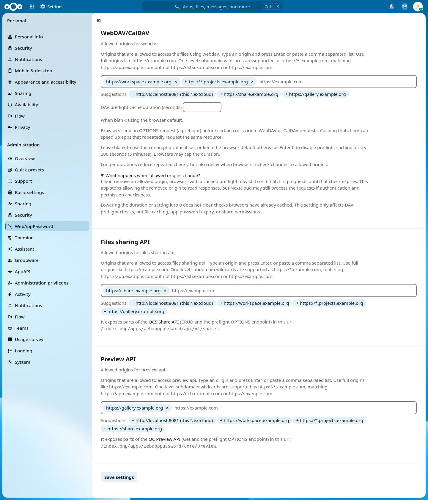
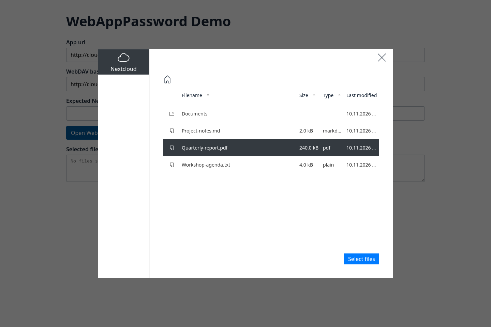
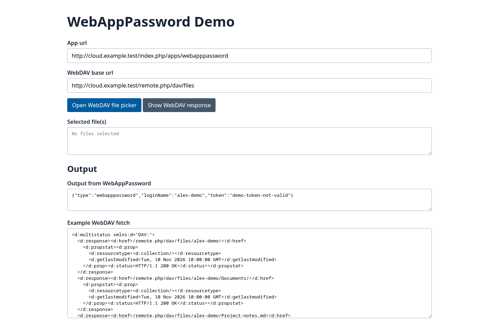

# [WebAppPassword](https://github.com/digital-blueprint/webapppassword)

[Nextcloud App Store](https://apps.nextcloud.com/apps/webapppassword) |
[Releases](https://github.com/digital-blueprint/webapppassword/releases) |
[Old releases](https://gitlab.tugraz.at/dbp/nextcloud/webapppassword/-/releases) |
[Changelog](https://github.com/digital-blueprint/webapppassword/blob/main/CHANGELOG.md) |
[Report issues](https://github.com/digital-blueprint/webapppassword/issues)

[](https://github.com/digital-blueprint/webapppassword/actions/workflows/test.yml)

This is a Nextcloud app to generate a temporary app password and set CORS headers to allow
WebDAV/CalDAV, Share API and Preview access from inside a webpage.

Place this app in **nextcloud/apps/** or install it from the [Nextcloud App Store](https://apps.nextcloud.com/apps/webapppassword).

## Configuration

You can configure the allowed origins for both WebDAV/CalDAV or files sharing api on the settings
page of the application.



Alternatively you can also add this setting to your `config/config.php`
(it will be used if the origins setting on the settings page are empty).

`'webapppassword.origins' => ['https://example.com'],` - array of allowed webdav/caldav origins

Origins must include the scheme, host and optional port. Paths are ignored. One-level subdomain
wildcards are supported in the host as `https://*.example.com`. This matches
`https://app.example.com`, but not `https://a.b.example.com` and not `https://example.com`.
Add the apex origin separately if it should also be allowed. The scheme and port still need to
match, so `https://*.example.com` does not allow `http://app.example.com`.

The setting is both used for the origin of the CORS headers for the WebDAV/CalDAV requests and
for the referrer check whether we want to generate a temporary app password.

### DAV preflight caching

The WebDAV/CalDAV section of the admin page lets you set **DAV preflight cache duration (seconds)**.
To configure it from `config/config.php` instead, use:

```php
'webapppassword.dav_cors_max_age' => 300,
```

An explicit admin UI value overrides `config.php`; clearing the field restores the fallback.
If neither is set, the app does not send `Access-Control-Max-Age` and the browser's existing
behavior is unchanged. Valid values are whole seconds from `0` (no preflight caching) to `7200`.
Browsers may impose a lower limit. Start with `300` seconds if your apps make repeated DAV requests.

This caches successful CORS preflight checks, not DAV responses, and does not change Nextcloud
authentication or permissions. If you remove an allowed origin, browsers with an existing cached
preflight may still send matching requests until it expires, even though the app stops allowing that
origin to read responses. Lowering the duration does not invalidate cached preflights.

### Share and Preview APIs

Also, you can configure in the same way the files sharing part.

`'webapppassword.files_sharing_origins' => ['https://example.com'],` - array of allowed files sharing api origins

Under the hood it exposes parts of the sharing api (CRUD and the preflight OPTIONS endpoint) in this url:
`https://example.com/index.php/apps/webapppassword/api/v1/shares`

Also, you can configure in the same way the files preview part.

`'webapppassword.preview_origins' => ['https://example.com'],` - array of allowed preview api origins

Under the hood it exposes parts of the preview api (get and the preflight OPTIONS endpoint) in this url:
`https://example.com/index.php/apps/webapppassword/core/preview`

## Docker

You can use this container for development and testing of the application.

```bash
cd docker
docker compose build
docker compose up
```

- <http://localhost:8081> admin/admin
- (first time only) For the origin config see `WEBPASSWORD_ORIGINS` in docker-compose.yml

### Regenerate screenshots

In the devenv development shell, run:

```bash
just screenshots
```

This writes three WebP screenshots to [`docs/screenshots/`](docs/screenshots/):
the admin settings, the example file picker, and the example WebDAV response.
The admin capture starts the local Docker app, waits for Nextcloud, and logs in
as `admin`/`admin`. It fills in fictional origins without saving them. The demo
captures use a fictional account, token, and files entirely inside Playwright;
they do not contact Nextcloud or any external website.

The Docker instance is left running. If Nextcloud reports a pending upgrade, run
`just upgrade` first. Playwright, Chromium, and `cwebp` are provided by the
development shell.

- Admin only: `just screenshot`.
- Demo only, without Docker: `python3 scripts/screenshots.py --demo-only`.
- Use an existing test instance without starting Docker: set `SCREENSHOT_URL`,
  `SCREENSHOT_USER`, and `SCREENSHOT_PASSWORD` and run `python3 scripts/screenshots.py`
  (add `--admin-only` to skip the demo captures).

Commit the regenerated images to update this README and the admin screenshot
referenced in `appinfo/info.xml` for the Nextcloud App Store.

## Example

You can start a php server with `cd docs/example && php -S localhost:8082` to see an example
page on <http://localhost:8082/>.

If you have started the docker container you can log in to your Nextcloud container with `admin`/`admin` and
receive a temporary app password for your user.

There also is the `FileSource` component of our [Nextcloud file picker](https://github.com/digital-blueprint/toolkit/tree/main/packages/file-handling)
in the example.



Take a look at [index.html](docs/example/index.html) for the source code of the page.



## Running tests

You can use the provided Makefile to run all tests by using:

```bash
cd docker && make test
```

## Generate translation

You will need the [translationtool](https://github.com/nextcloud/docker-ci/tree/master/translations/translationtool)
to generate the translation files for all languages.

```bash
php /path/to/translationtool.phar convert-po-files
```

See: [Manual translation](https://docs.nextcloud.com/server/19/developer_manual/app/view/l10n.html#manual-translation)

## Releasing

See [Signing and releasing](docs/deployment.md) for the GitHub Actions setup,
Nextcloud signing credentials, automated release procedure and recovery steps.

## References

This Nextcloud application is used in the
[NextcloudFilePicker]https://github.com/digital-blueprint/toolkit/blob/main/packages/file-handling/src/nextcloud-file-picker.js)
web component to generate temporary app passwords and to allow WebDAV-access from
inside the web browser.

---

This project is tested with BrowserStack.
